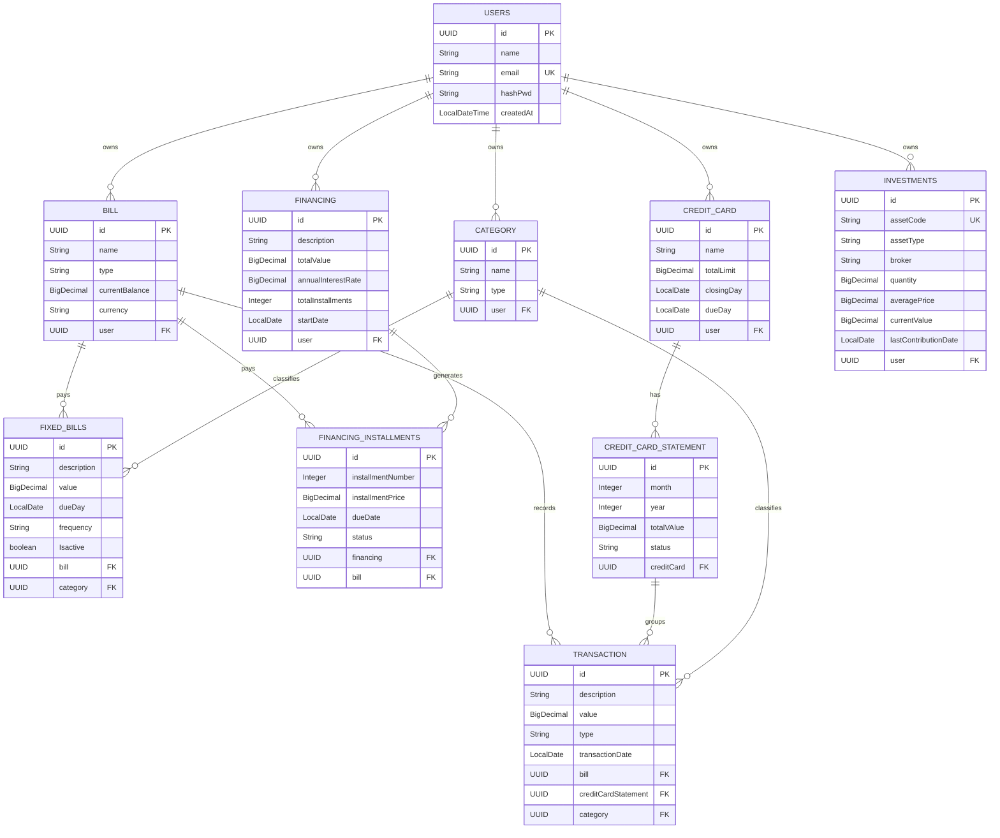

# Oque é a <strong>Vaultify</strong>
## Vaultify é um sistema de gestão financeira que permite gerenciar suas finanças, dividas, prestações e investimentos em uma unica aplicação web. <br>
### A ideia surgiu da minha necessidade constante de anotra meus gastos e gerenciar investimentos, porem utilizando planilhas diferentes, outros site para utilizar como carteira de investimentos tudo acabava uma bagunça e minha conta zerada. <br> Foi ai que surgiu a ideia da <strong>Vaultify</strong>, como um sistema seguro, confiavel e expansivel. <br>O Projeto esta em atual desenvolvimento, contendo atualmente tecnologias como... que serão atualizadas diariamente a cada desafio novo que surgir, colocando em pratica oque estou continuamente estudando
# Modelo Relacional e Diagrama - Sistema de Gerenciamento de Finanças

## 1. Diagrama de Entidade-Relacionamento (ER)

O diagrama abaixo descreve a estrutura das tabelas, chaves primárias (PK), chaves estrangeiras (FK) e os relacionamentos entre os módulos de usuários, contas, cartões, despesas, financiamentos e investimentos.


---


---

## 2. Principais Decisões Arquiteturais

1. **Separação de Gastos:**
    - **Transações:** Atende aos gastos variáveis/aleatórios. Aceita débito direto em conta ou vínculo com a fatura do cartão de crédito através de uma restrição `CHECK`.
    - **Contas Fixas:** Tabela separada para servir como modelo/agendador do que precisa ser cobrado periodicamente.
    - **Financiamentos:** Tabela de financiamento desacoplada que gera N registros em `parcelas_financiamento`, permitindo liquidação individual.
2. **Módulo Isolado de Investimentos:**
    - A tabela `investimentos` foi desenhada para guardar posição e saldo sem misturar com transações do dia a dia, facilitando operações de rentabilidade e integração com APIs externas de cotações.
3. **Tipos e Precisão Monetária:**
    - Todos os valores utilizam `DECIMAL(15, 2)` para evitar problemas de arredondamento inerentes ao tipo `FLOAT`.
    - A quantidade de ativos em investimentos usa `DECIMAL(18, 8)` para permitir frações de criptomoedas ou cotas fracionadas.


## Como Funciona a Geração de Token Via JWT

<strong>JWT</strong> ou <strong>J</strong>ason <strong>W</strong>eb <strong>T</strong>oken é uma um token assinado digitalmente ou criptografado que garante a seção do usuario, permitindo navegar pela aplicação con suas credencias salvas em sua seção retirando a necessidade de autenticar o usuario a cada requisição.
## Fluxo de authenticação por <strong>JWT</strong> 
```markdown
📁 Fluxo de authenticação por JWT
│
├── 📁 1. Classe de Serviço -> JwtService
│   ├── 📄 Criar Token
│   ├── 📄 Validar Token
│   └── 📄 Extrair Claims / Subject
│
├── 📁 2. Classe Filtro/Guardiã -> JwtAuthenticationFilter
│   ├── 📄 Interceptar Requisição HTTP
│   ├── 📄 Ler Header Authorization
│   ├── 📄 Validar Token
│   └── 📄 Popular Contexto de Segurança
│
├── 📁 3. Porta de Entrada -> AuthController
│   ├── 📄 Receber Credenciais
│   ├── 📄 Autenticar Usuário
│   └── 📄 Retornar JWT
│
└── 📁 4. Regras do Spring -> SecurityConfig
    ├── 📄 Configurar Sessão STATELESS
    ├── 📄 Desabilitar CSRF
    ├── 📄 Configurar Rotas públicas/privadas
    └── 📄 Injetar Filtro na Cadeia de Segurança
```