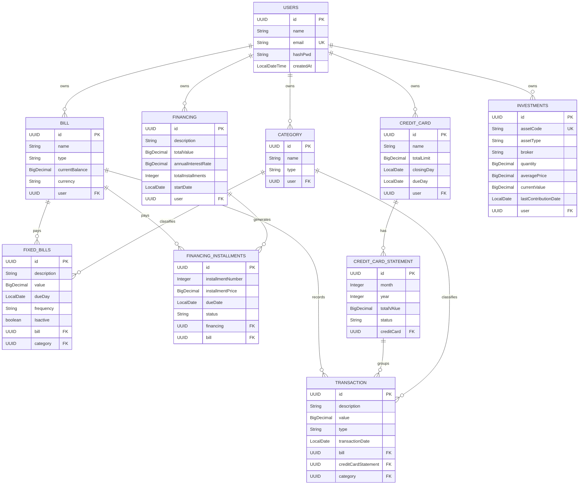

<div align="center">

# 🔐 Vaultify

**Gestão financeira pessoal em uma única aplicação web.**
Contas, cartões, dívidas, financiamentos e investimentos — tudo centralizado, seguro e expansível.


</div>

---

## 📑 Sumário

- [Sobre o projeto](#-sobre-o-projeto)
- [O que já foi implementado](#-o-que-já-foi-implementado)
- [Tecnologias](#-tecnologias)
- [Arquitetura e estrutura](#-arquitetura-e-estrutura)
- [Modelo de dados](#-modelo-de-dados)
- [Decisões de projeto](#-decisões-de-projeto)
- [Endpoints](#-endpoints)
- [Como executar](#-como-executar)
- [Próximos passos](#-próximos-passos)
- [Autor](#-autor)

---

## 💡 Sobre o projeto

A **Vaultify** nasceu de uma necessidade real: controlar gastos em uma planilha, acompanhar investimentos em outro site, anotar dívidas em outro lugar — e, no fim, ter tudo espalhado e o saldo no vermelho.

A proposta é reunir **finanças, dívidas, parcelas e investimentos** em um único sistema, construído para ser **seguro, confiável e expansível**.

O projeto está em **desenvolvimento ativo** e evolui a cada novo desafio, servindo também como laboratório para colocar em prática o que venho estudando continuamente.

---

## ✅ O que já foi implementado

| Módulo | Descrição | Status |
|---|---|---|
| **Modelagem de dados** | 10 entidades JPA mapeadas com relacionamentos, chaves UUID e carregamento *lazy* | ✅ Concluído |
| **Cadastro de usuário** | Criação de conta com validação de dados e persistência no MySQL | ✅ Concluído |
| **Segurança de senha** | Política de senha forte + hash com **BCrypt** antes de salvar | ✅ Concluído |
| **Página de login** | Tela renderizada pelo servidor (Thymeleaf) com HTML, CSS e JavaScript | ✅ Concluído |
| **Autenticação** | Endpoint de login e integração com a tela | 🚧 Em evolução |

### Política de senha

Ao cadastrar um usuário, a senha precisa conter:

- mínimo de **8 caracteres**
- ao menos **1 letra maiúscula** e **1 minúscula**
- ao menos **1 número**
- ao menos **1 caractere especial**

Senhas fora do padrão são rejeitadas com `400 Bad Request`. As aceitas são armazenadas apenas como **hash BCrypt** — a senha original nunca é persistida.

---

## 🛠 Tecnologias

| Camada | Tecnologia |
|---|---|
| **Linguagem** | Java 21 |
| **Framework** | Spring Boot 4.1.1 (Spring Web MVC) |
| **Persistência** | Spring Data JPA / Hibernate |
| **Banco de dados** | MySQL |
| **Segurança** | Spring Security (`BCryptPasswordEncoder`) |
| **Front-end** | Thymeleaf, HTML5, CSS3, JavaScript |
| **Documentação de API** | springdoc-openapi |
| **Produtividade** | Lombok, Spring Boot DevTools |
| **Build** | Maven (Maven Wrapper incluso) |

---

## 🧱 Arquitetura e estrutura

O projeto segue uma organização em camadas, separando responsabilidades de apresentação, regra de negócio e acesso a dados.

```text
Vaultify
├── src/main
│   ├── java/com/carmo/Vaultify
│   │   ├── Configuration/        # Configurações (beans de segurança / PasswordEncoder)
│   │   ├── Controller/           # Endpoints REST e renderização de páginas
│   │   ├── Dto/                  # Objetos de transferência de dados
│   │   ├── Service/              # Regras de negócio
│   │   ├── Validator/            # Validações (política de senha)
│   │   ├── Database/
│   │   │   ├── Entity/           # Entidades JPA (10 tabelas)
│   │   │   └── Repository/       # Repositórios Spring Data
│   │   └── VaultifyApplication.java
│   └── resources
│       ├── templates/            # Páginas Thymeleaf (login.html)
│       ├── static/               # CSS, JavaScript e imagens
│       └── application.properties
├── pom.xml
└── mvnw / mvnw.cmd
```

**Fluxo de uma requisição:** `Controller → Service → Repository → MySQL`

---

## 🗄 Modelo de dados

O diagrama abaixo descreve as tabelas, chaves primárias (PK), chaves estrangeiras (FK) e os relacionamentos entre os módulos de **usuários, contas, cartões, despesas, financiamentos e investimentos**.



---

## 🧠 Decisões de projeto

**1. Separação dos tipos de gasto**
- **Transações** — gastos variáveis. Podem ser lançadas direto em uma conta (`BILL`) ou vinculadas à fatura de um cartão de crédito (`CREDIT_CARD_STATEMENT`).
- **Contas fixas** — tabela própria (`FIXED_BILLS`) que funciona como modelo do que é cobrado periodicamente, com frequência e flag de ativação.
- **Financiamentos** — entidade desacoplada (`FINANCING`) que gera N parcelas (`FINANCING_INSTALLMENTS`), permitindo acompanhar o status de cada uma individualmente.

**2. Módulo isolado de investimentos**
A tabela `INVESTMENTS` guarda posição, preço médio e valor atual sem se misturar com as transações do dia a dia, o que facilita cálculos de rentabilidade no futuro.

**3. Precisão monetária**
Todos os valores financeiros usam `BigDecimal`, evitando os erros de arredondamento de `float`/`double`. A quantidade de ativos também é `BigDecimal`, preparada para frações de cotas.

**4. Identificadores e performance**
Chaves primárias do tipo **UUID** e relacionamentos `@ManyToOne` com carregamento **LAZY**.

**5. Isolamento por usuário**
Contas, cartões, categorias, financiamentos e investimentos pertencem a um usuário (`USER_ID`), deixando o modelo preparado para multiusuário.

**6. Configuração fora do código**
Credenciais do banco são lidas de **variáveis de ambiente**, sem dados sensíveis no repositório.

---

## 🔌 Endpoints

| Método | Rota | Descrição | Retorno |
|---|---|---|---|
| `GET` | `/login` | Renderiza a página de login | Página HTML |
| `PUT` | `/api/login` | Cadastra um novo usuário (valida senha e aplica hash BCrypt) | `201 Created` · `400 Bad Request` |
| `POST` | `/api/login` | Consulta o usuário por e-mail e valida as credenciais *(em evolução)* | `boolean` |

**Exemplo — cadastro de usuário**

```http
PUT /api/login
Content-Type: application/json

{
  "name": "Maria Silva",
  "email": "maria@email.com",
  "hashPwd": "Senha@123"
}
```

---

## 🚀 Como executar

### Pré-requisitos

- **Java 21**
- **MySQL** em execução
- Maven (opcional — o projeto já inclui o Maven Wrapper)

### 1. Clone o repositório

```bash
git clone https://github.com/iamytz/Vaultify.git
cd Vaultify
git checkout core
```

### 2. Configure as variáveis de ambiente

| Variável | Exemplo |
|---|---|
| `DATABASE_URL` | `jdbc:mysql://localhost:3306/vaultify?createDatabaseIfNotExist=true` |
| `DATABASE_USERNAME` | `root` |
| `DATABASE_PWD` | `sua_senha` |

**Linux / macOS**
```bash
export DATABASE_URL="jdbc:mysql://localhost:3306/vaultify?createDatabaseIfNotExist=true"
export DATABASE_USERNAME="root"
export DATABASE_PWD="sua_senha"
```

**Windows (PowerShell)**
```powershell
$env:DATABASE_URL="jdbc:mysql://localhost:3306/vaultify?createDatabaseIfNotExist=true"
$env:DATABASE_USERNAME="root"
$env:DATABASE_PWD="sua_senha"
```

### 3. Execute a aplicação

```bash
./mvnw spring-boot:run      # Linux / macOS
mvnw.cmd spring-boot:run    # Windows
```

As tabelas são criadas automaticamente pelo Hibernate na primeira execução. A aplicação sobe em **http://localhost:8080** e a tela de login fica em `/login`.

---

## 🗺 Próximos passos

- [x] Modelagem completa do banco de dados
- [x] Cadastro de usuário com política de senha e hash
- [x] Página de login
- [ ] Autenticação completa de usuários
- [ ] Camadas de serviço e API para contas, cartões, transações, financiamentos e investimentos
- [ ] Telas de gestão financeira

---

## 👨‍💻 Autor

Desenvolvido por **[iamytz](https://github.com/iamytz)**.

Projeto em constante evolução — sugestões e feedbacks são bem-vindos!!
<div align="center">

<a href="https://github.com/iamytz">

</a>
<a href="https://www.linkedin.com/in/gabriel-carmo-pe/">

</a>

<br> <br>

⭐ *Se você gostou do Vaultify, deixe uma estrela no repositório!*
</div>


<div align="center">

Desenvolvido com dedicação, aprendizado contínuo e foco em evolução técnica.

</div>